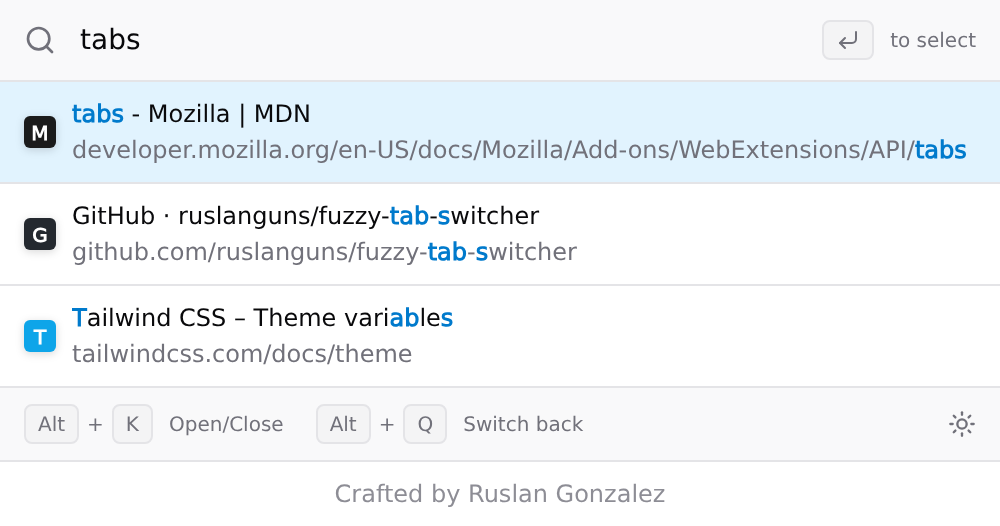

<div align="center">


# Fuzzy Tab Switcher

**Find any open tab in a few keystrokes.**<br />
Press <kbd>Alt</kbd>+<kbd>K</kbd>, type a few letters, hit <kbd>Enter</kbd>. Works across every window.

[](https://github.com/ruslanguns/fuzzy-tab-switcher/releases/latest)
[](LICENSE)


<picture>
  <source media="(prefers-color-scheme: dark)" srcset="docs/images/screenshot-dark.png" />
  
</picture>

</div>

## Features

- **Fuzzy search** over tab titles and URLs, with matched characters highlighted.
- **All windows at once**: switching to a tab focuses its window.
- **Smart ordering**: best match first, ties broken by most recently used.
- **Quick switch** back to your previous tab with <kbd>Alt</kbd>+<kbd>Q</kbd>.
- **Light, dark or system theme.**
- **Private by design**: no network requests, only the `tabs` and `storage` permissions. See [PRIVACY.md](PRIVACY.md).

## Shortcuts

| Shortcut                                    | Action                         |
| :------------------------------------------ | :----------------------------- |
| <kbd>Alt</kbd>+<kbd>K</kbd>                 | Open / close the switcher      |
| <kbd>Alt</kbd>+<kbd>Q</kbd>                 | Switch to the previous tab     |
| <kbd>↑</kbd> <kbd>↓</kbd> · <kbd>Tab</kbd> / <kbd>Shift</kbd>+<kbd>Tab</kbd> | Move the selection |
| <kbd>Enter</kbd>                            | Go to the selected tab         |
| <kbd>Esc</kbd>                              | Close                          |

In Safari on macOS they are <kbd>⌘</kbd>+<kbd>K</kbd> and <kbd>⌘</kbd>+<kbd>Shift</kbd>+<kbd>K</kbd>. You can change them in your browser's extension shortcut settings.

## Install

Download the zip for your browser from the [latest release](https://github.com/ruslanguns/fuzzy-tab-switcher/releases/latest), or [build it yourself](#development), then load it:

- **Chrome / Brave / Edge**: `chrome://extensions` → enable *Developer mode* → *Load unpacked* → select `dist/chrome`.
- **Firefox**: `about:debugging` → *This Firefox* → *Load Temporary Add-on…* → select `dist/firefox/manifest.json` (removed when Firefox restarts).
- **Safari**: `xcrun safari-web-extension-converter dist/safari`, then build and run it in Xcode.

## Development

Requires Node.js 18+.

```bash
git clone https://github.com/ruslanguns/fuzzy-tab-switcher.git
cd fuzzy-tab-switcher
npm install
npm run build:chrome   # or build:firefox / build:safari → dist/<browser>
```

| Script                       | Purpose                                  |
| :--------------------------- | :--------------------------------------- |
| `npm run build:<browser>`    | Build into `dist/<browser>`              |
| `npm run package:<browser>`  | Build and zip for distribution           |
| `npm run lint` / `lint:fix`  | Lint and format with Biome               |

Built with [Preact](https://preactjs.com) + Signals, [Tailwind CSS](https://tailwindcss.com) and [Vite](https://vite.dev).

## License

[MIT](LICENSE) © [Ruslan Gonzalez](https://x.com/ruslanguns)
